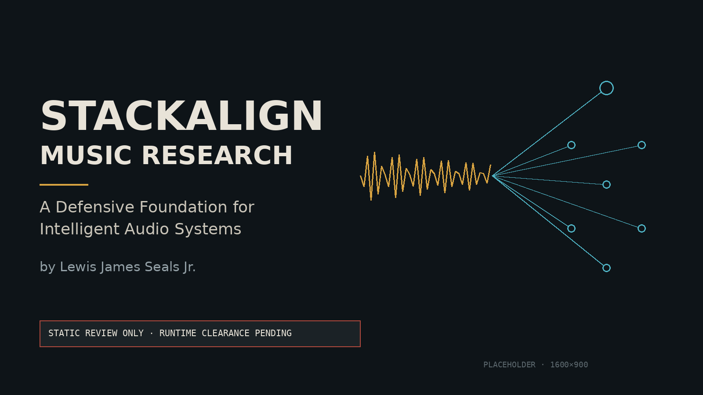

# StackAlign Music Research

**A Defensive Foundation for Intelligent Audio Systems**
Servers · Language Models · Music Production

By Lewis James Seals Jr.
With thanks to Laila Star Seals and Lawrence James Seals.

> **STATIC REVIEW ONLY · RUNTIME CLEARANCE PENDING**

## About

A 12-chapter manual on using the StackAlign baseline as a shared defensive foundation for base servers, LLM creation and music production (HUSH Core, HUSH Processor, Sculptor, Observatory, Archive). It covers four primitives: fixed path safety, allowlisted execution through `sa_exec`, atomic writes, and integrity verification.

The book does not claim runtime clearance. It documents the gates required before anyone can.

## Contents

- `book/index.html` — full manuscript, covers and diagrams appendix (open in a browser)
- `images/cover-placeholder.png` — 1800×2700 cover placeholder (6:9)
- `images/x-social-placeholder.png` — 1600×900 placeholder for x.com

## Status

Static review only. K4 (`sa_exec` caller migration), history undo, config atomic writer callers and the root-apply chain remain open; EL9 runtime validation is pending.
